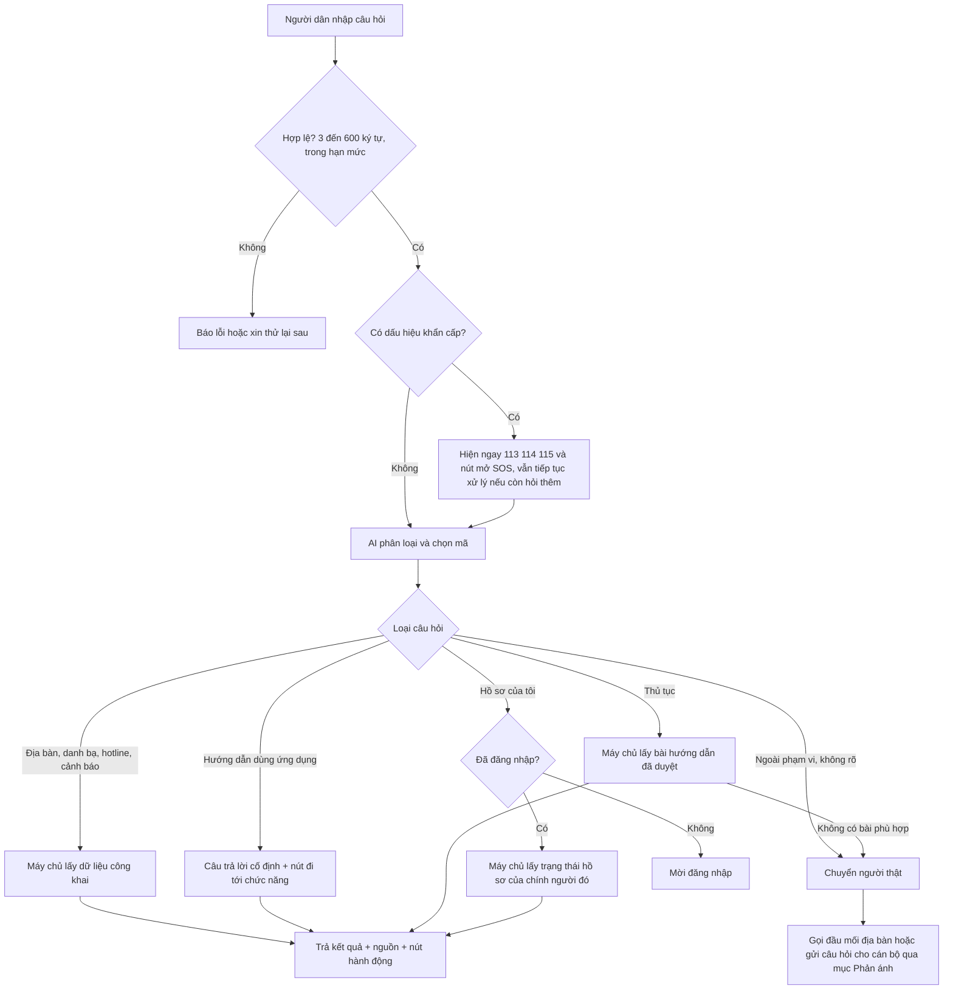

# Luồng trợ lý AI hỗ trợ người dân

Ngày chốt: 2026-11-01. Bổ sung cho `ai-map-integration.md` (cấu hình và giới hạn kỹ thuật). Tài liệu này chốt **trợ lý được làm gì, trả lời theo luồng nào, và khi nào chuyển cho người thật**.

Trạng thái từng phần: **Đã có** (mã đã làm), **Chốt** (quy tắc đã quyết, chưa làm), **Chờ ngoài** (cần đơn vị khác).
Hiện tại AI **chưa bật** trên bandosocskv.com: máy chủ chưa có `AI_PROVIDER`, `AI_MODEL` và khóa. Trợ lý vẫn dùng được ở chế độ **tra cứu theo tên** (không AI, ghi rõ trên giao diện): tìm xã/phường, danh bạ, hotline, cảnh báo, hướng dẫn dùng, và nhận biết khẩn cấp. Có khóa thì tự chuyển sang AI; AI lỗi hoặc hết ngân sách ngày thì tự lùi về tra cứu theo tên thay vì báo lỗi.

## Vai trò

Trợ lý là **người hướng dẫn và tra cứu**, không phải người xử lý hồ sơ. Nó giúp người dân tìm đúng thông tin hoặc đúng chức năng, rồi trao cho cán bộ khi cần.

Trợ lý không bao giờ: nhận SOS, tạo phản ánh thay người dân, phân công cán bộ, đưa ý kiến pháp lý, trả lời về hồ sơ của người khác, hoặc tự viết nội dung ngoài nguồn đã duyệt.

## Nguyên tắc cốt lõi

1. **AI chỉ phân loại, máy chủ mới trả lời.** Mô hình chỉ chọn loại câu hỏi và mã (địa bàn, đầu mối, bài hướng dẫn). Nội dung hiển thị do máy chủ lấy từ nguồn công khai hoặc đã duyệt, mã nào ngoài danh mục bị từ chối. Vì vậy trợ lý không thể bịa số điện thoại, địa chỉ hay thủ tục. Đã có.
2. **Không có nguồn thì nói không biết**, rồi chuyển người thật. Không đoán, không dùng kiến thức chung của mô hình. Đã có cho địa bàn và danh bạ; Chốt cho thủ tục.
3. **Khẩn cấp không phụ thuộc AI.** Câu có dấu hiệu nguy hiểm (cứu, cháy, đánh nhau, tai nạn, bị hại, cướp...) hiện ngay khối "Gọi 113, 114, 115 hoặc mở SOS", không chờ mô hình và vẫn hiện khi AI lỗi hay chưa cấu hình. Đã có: máy chủ kiểm tra trước khi gọi mô hình, và ô hỏi không còn bị khóa khi AI chưa bật.
4. **Không lưu nội dung câu hỏi.** Giữ nguyên quy định hiện có: không ghi câu hỏi vào cơ sở dữ liệu hay trình duyệt. Chỉ được đếm theo loại (ví dụ số lần "không trả lời được") để biết kho hướng dẫn còn thiếu gì.
5. **Nói rõ nguồn và độ mới** dưới mỗi câu trả lời. Đã có; Chốt thêm ngày duyệt cho bài hướng dẫn.

## Luồng một câu hỏi

## Các nhánh

| Nhánh | Trợ lý trả lời gì | Nguồn | Nút hành động | Trạng thái |
| --- | --- | --- | --- | --- |
| Địa bàn, trụ sở | Tên, dân số, diện tích, địa chỉ trụ sở | Dữ liệu địa bàn trong PostGIS | Xem trên bản đồ | Đã có |
| Danh bạ, hotline | Cán bộ, đầu mối, số đường dây nóng | Danh bạ công khai | Gọi | Đã có |
| Cảnh báo | Cảnh báo đang hiệu lực của địa bàn | Cảnh báo do cán bộ phát hành | Xem trên bản đồ | Đã có |
| Hướng dẫn dùng ứng dụng | Cách tìm địa bàn, gửi phản ánh, dùng SOS | Văn bản cố định trong mã | Mở Phản ánh, mở SOS | Đã có (một đoạn chung), Chốt tách theo chức năng |
| Khẩn cấp | Không xử lý; chỉ dẫn gọi 113, 114, 115 và mở SOS, nói rõ SOS chưa nối 112/113 | Văn bản cố định | Mở SOS, gọi | Đã có, kiểm tra cục bộ |
| Thủ tục | Bài hướng dẫn ngắn: cần giấy tờ gì, nộp ở đâu, liên hệ ai | **Kho hướng dẫn đã duyệt** (mới) | Gọi đầu mối, hỏi cán bộ | Chốt. Chờ ngoài: nội dung và người duyệt |
| Hồ sơ của tôi | Trạng thái và người phụ trách hồ sơ của chính người hỏi | API hồ sơ có sẵn, theo phiên đăng nhập | Mở hồ sơ | Chốt. Mô hình không bao giờ thấy dữ liệu hồ sơ |
| Ngoài phạm vi | Nói rõ không hỗ trợ và đưa lối đi khác | Văn bản cố định | Gọi đầu mối, hỏi cán bộ | Đã có (câu chung), Chốt thêm nút |

## Chuyển cho người thật

Trợ lý chuyển khi gặp một trong các trường hợp: ngoài phạm vi; thủ tục chưa có bài đã duyệt; hỏi lại hai lần vẫn chưa rõ địa bàn; người dân bấm "chưa đúng ý".

Cách chuyển, theo thứ tự ưu tiên:
1. **Gọi đầu mối của địa bàn** đang xem (số lấy từ danh bạ công khai). Đã có dữ liệu, Chốt nút.
2. **Hỏi cán bộ**: mở mục Phản ánh với nhóm "Thủ tục hành chính", điền sẵn câu hỏi để người dân sửa rồi gửi. Dùng luồng phản ánh sẵn có nên cán bộ trả lời qua mục trao đổi và người dân được thông báo; không tạo luồng mới. Chốt, cần đăng nhập.
3. Tình huống nguy hiểm: luôn là 113, 114, 115 trước, không qua bước nào khác.

## Kho hướng dẫn đã duyệt (mới)

Thủ tục là phần người dân hỏi nhiều nhất và là phần dễ sai nhất, nên không để mô hình tự trả lời.
- Mỗi bài: tiêu đề, nội dung ngắn, nguồn (tên văn bản hoặc đơn vị), phạm vi địa bàn, ngày duyệt, ngày hết hạn, người duyệt.
- Vòng đời: bản nháp (cán bộ soạn) → được duyệt (chỉ huy địa bàn) → đang dùng → hết hạn. Bài hết hạn tự ngừng hiển thị.
- Mô hình chỉ nhận **danh sách tiêu đề và mã bài**, chọn mã phù hợp; máy chủ trả nguyên văn bài đã duyệt. Cùng cơ chế với địa bàn và hotline hiện nay.
- Chờ ngoài: ai soạn, ai duyệt, bộ thủ tục khởi đầu (đề xuất 10 đến 15 thủ tục người dân hỏi nhiều nhất ở địa bàn thí điểm).

## Cần có trước khi bật cho người dân thật

1. Đặt trên máy chủ `AI_PROVIDER=gemini`, `AI_MODEL`, `GEMINI_API_KEY` (bạn tự nhập khóa trên máy chủ, không gửi qua chat), khởi động lại API.
2. Chạy bộ ít nhất 30 câu hỏi thật: tên trùng, sai dấu, địa bàn không tồn tại, ngoài phạm vi, khẩn cấp, thử ép AI bỏ quy tắc. Ghi kết quả; chưa đạt thì không bật.
3. Xem lại chính sách lưu giữ dữ liệu của nhà cung cấp với bên chịu trách nhiệm dữ liệu.
4. Giữ hạn mức hiện có: 600 ký tự, 6 yêu cầu mỗi phút mỗi IP, 200 lượt mỗi ngày, chờ tối đa 15 giây. Đặt thêm ngân sách ở phía nhà cung cấp, vì bộ đếm trong ứng dụng mất khi khởi động lại.
5. Giao diện phải ghi rõ: câu hỏi gửi tới nhà cung cấp, không nhập thông tin cá nhân, không dùng để báo khẩn cấp. Đã có.

## Thứ tự làm

1. Kiểm tra khẩn cấp cục bộ và nút hành động (gọi đầu mối, hỏi cán bộ): nhỏ, không phụ thuộc ai, làm được ngay.
2. Bật Gemini trên máy chủ và chạy bộ 30 câu hỏi.
3. Kho hướng dẫn đã duyệt và nhánh Thủ tục, khi đã có người soạn và người duyệt.
4. Nhánh "Hồ sơ của tôi".
5. Bộ đếm theo loại để biết thủ tục nào còn thiếu.
