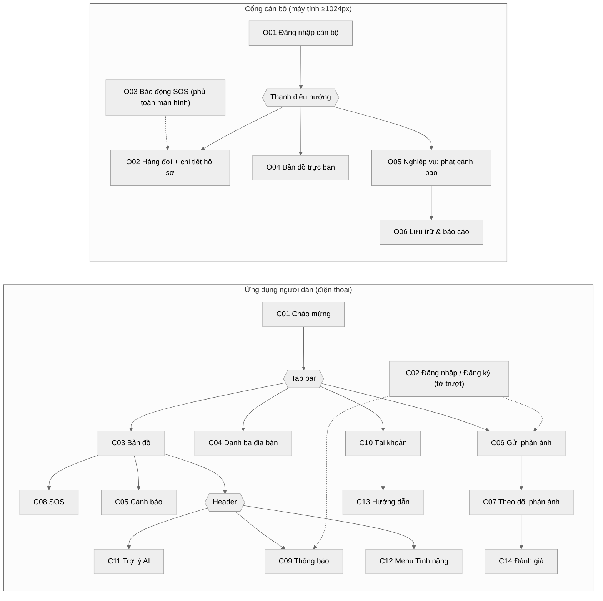

# Sơ đồ điều hướng (Sitemap & Navigation)

Nguồn chỉnh sửa: [`diagrams/sitemap.mmd`](diagrams/sitemap.mmd) (Mermaid) · ảnh vector: [`sitemap.svg`](diagrams/sitemap.svg).

## Danh mục màn hình
| Mã | Tên | Nhóm | Vào từ | Đường dẫn trong prototype |
|---|---|---|---|---|
| C01 | Chào mừng | Người dân | Mở app | `#c01` |
| C02 | Đăng nhập / Đăng ký (tờ trượt) | Người dân | Phản ánh, Thông báo, Tài khoản | `#c02` |
| C03 | Bản đồ | Người dân | Tab 1, mặc định | `#c03` |
| C04 | Danh bạ địa bàn | Người dân | Tab 2 | `#c04` |
| C05 | Cảnh báo | Người dân | Bản đồ, Menu Tính năng | `#c05` |
| C06 | Gửi phản ánh | Người dân | Tab 3 | `#c06` |
| C07 | Theo dõi phản ánh | Người dân | Sau khi gửi, Thông báo | `#c07` |
| C08 | SOS | Người dân | Nút SOS nổi trên bản đồ | `#c08` |
| C09 | Thông báo | Người dân | Chuông trên header | `#c09` |
| C10 | Tài khoản | Người dân | Tab 4 | `#c10` |
| C11 | Trợ lý AI | Người dân | Nút “Trợ lý” trên header | `#c11` |
| C12 | Menu Tính năng | Người dân | Nút “Tính năng” trên header | `#c12` |
| C13 | Hướng dẫn | Người dân | Tài khoản, lần đầu | `#c13` |
| C14 | Đánh giá | Người dân | Sau khi hồ sơ có kết quả | `#c14` |
| O01 | Đăng nhập cán bộ | Cán bộ | Mở cổng | `#o01` |
| O02 | Hàng đợi + chi tiết hồ sơ | Cán bộ | Nav “Hàng đợi” | `#o02` |
| O03 | Báo động SOS | Cán bộ | Tự bật khi có SOS | `#o03` |
| O04 | Bản đồ trực ban | Cán bộ | Nav “Bản đồ” | `#o04` |
| O05 | Nghiệp vụ – Phát cảnh báo | Cán bộ | Nav “Nghiệp vụ” | `#o05` |
| O06 | Lưu trữ & báo cáo | Cán bộ | Nghiệp vụ › Lưu trữ | `#o06` |

## Quy tắc điều hướng
- **Người dân (điện thoại):** 4 tab dưới đáy — *Bản đồ · Danh bạ · Phản ánh · Tài khoản*. Thanh trên cùng giữ 3 nút có chữ: *Trợ lý · Thông báo · Tính năng*. SOS là nút nổi (không thuộc tab) nên luôn dùng được.
- **Tối đa 3 cấp:** Tab → màn → tờ trượt/chi tiết. Nút “Quay lại” luôn ở góc trái trên của màn con; vuốt cạnh trái (cử chỉ hệ thống Android) cũng quay lại.
- **Đăng nhập là tờ trượt, không phải màn riêng:** đóng tờ trượt → về đúng màn trước, giữ nội dung đã nhập.
- **Cán bộ (máy tính):** thanh trên cùng 3 mục — *Hàng đợi · Bản đồ · Nghiệp vụ*; dưới 1024 px chuyển thành thanh tab đáy. Báo động SOS (O03) phủ lên mọi mục.
- **Mục đang mở** luôn có 3 dấu hiệu: màu chủ đạo, chữ đậm, thanh chỉ báo — không chỉ dựa vào màu.
- **Bản Android người dân** không chứa lối vào cổng cán bộ.
