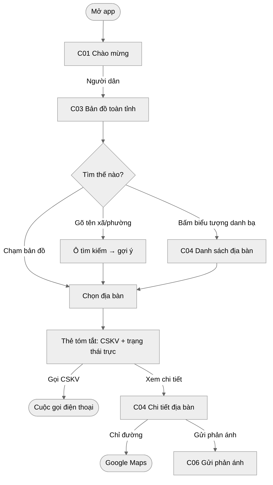
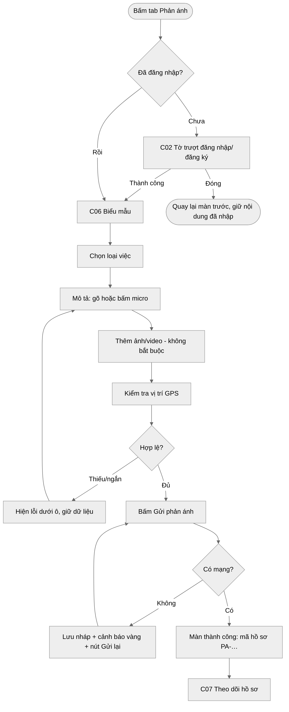
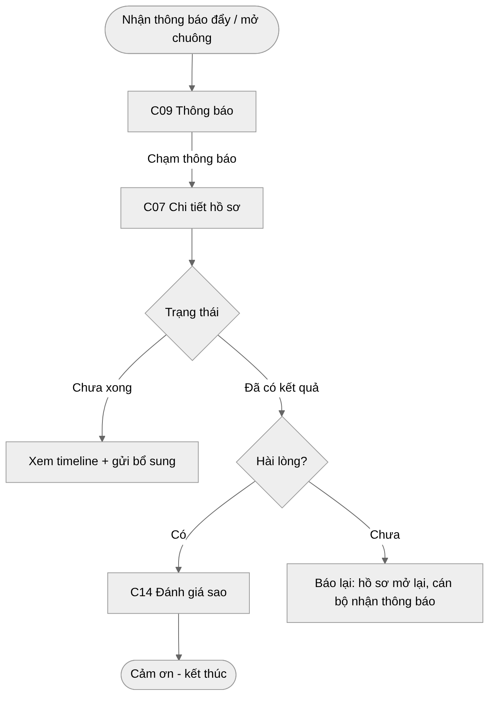
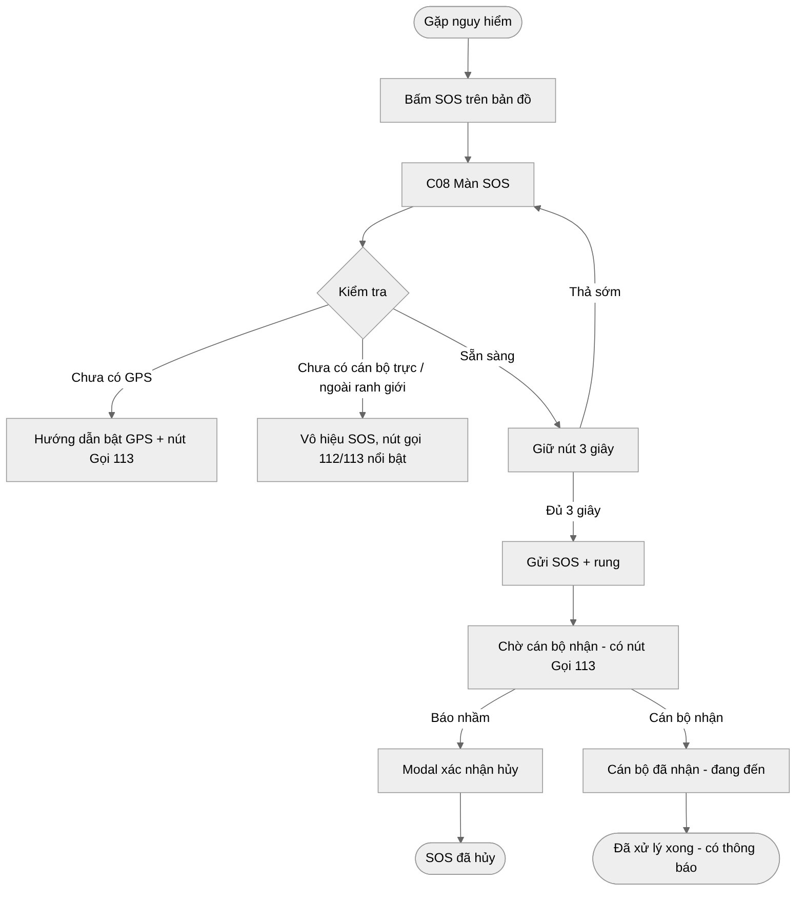
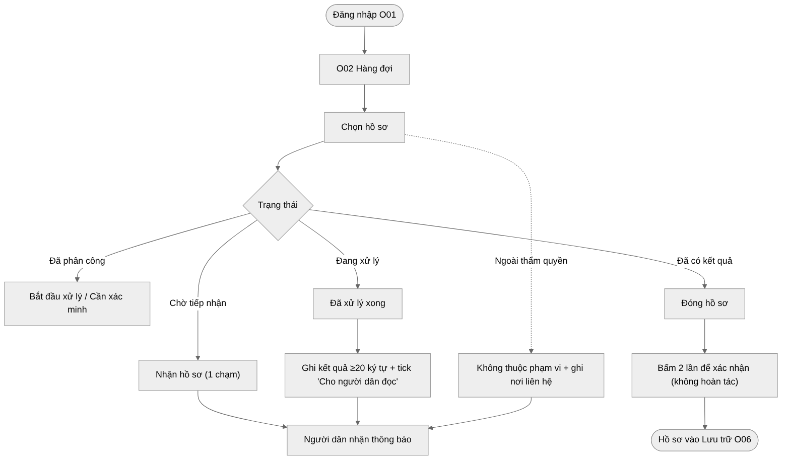
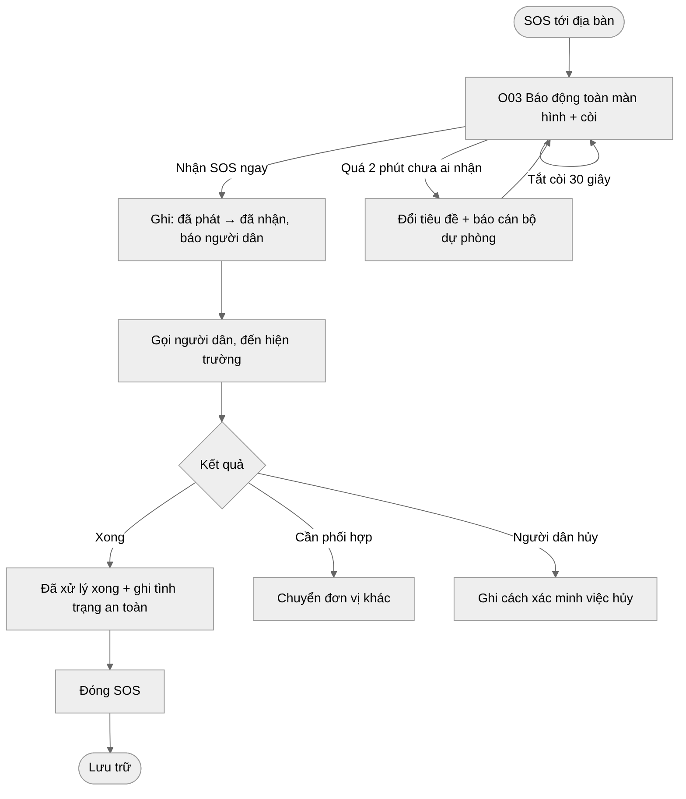
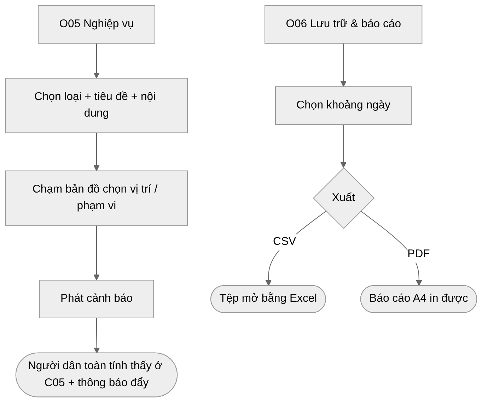

# Luồng người dùng chính (User flow)

Bảy luồng quan trọng nhất. Mỗi luồng là một sơ đồ Mermaid (nguồn `.mmd`, ảnh `.png`/`.svg` trong `diagrams/`) và dùng đúng mã màn hình ở `03-screens/`.

| # | Luồng | Người dùng | Màn hình | Thước đo thành công |
|---|---|---|---|---|
| F1 | Tra cứu CSKV rồi gọi | Người dân | C01 → C03 → C04 | ≤ 3 chạm từ mở app đến nút Gọi |
| F2 | Gửi phản ánh | Người dân | C06 (± C02) → C07 | Gửi trong ≤ 60 giây; không mất dữ liệu khi lỗi mạng |
| F3 | Theo dõi hồ sơ | Người dân | C09 → C07 → C14 | Thấy trạng thái mới nhất ngay khi mở |
| F4 | SOS | Người dân | C03 → C08 | Giữ 3 giây gửi thành công; nhận phản hồi “đã nhận” |
| F5 | Xử lý hồ sơ | Cán bộ | O01 → O02 | Mỗi bước 1 nút; kết quả có ghi chú |
| F6 | Nhận báo động SOS | Cán bộ | O03 → O02 | Nhận ≤ 2 phút; không bỏ lỡ |
| F7 | Phát cảnh báo & báo cáo | Cán bộ | O05 → O06 | Phát ≤ 1 phút; xuất báo cáo 1 chạm |

## F1 · Tra cứu công an khu vực rồi gọi

## F2 · Gửi phản ánh

## F3 · Theo dõi hồ sơ

## F4 · SOS (người dân)

## F5 · Cán bộ xử lý hồ sơ

## F6 · Cán bộ nhận báo động SOS

## F7 · Phát cảnh báo & xuất báo cáo

## Trạng thái hồ sơ (dùng chung người dân & cán bộ)
| Mã nội bộ | Chữ hiển thị cho người dân | Chữ cho cán bộ | Màu trạng thái |
|---|---|---|---|
| submitted | Đã gửi | Chờ tiếp nhận | info |
| received | Đã tiếp nhận | Đã tiếp nhận | info |
| assigned | Đã giao cán bộ | Đã phân công | info |
| processing | Đang xử lý | Đang xử lý | warning |
| resolved | Đã có kết quả | Đã có kết quả | success |
| closed | Đã đóng | Đã đóng | neutral |
| rejected | Không thuộc phạm vi | Ngoài phạm vi | neutral |

> Mọi trạng thái đều có **chữ + biểu tượng chấm**, không chỉ màu.
